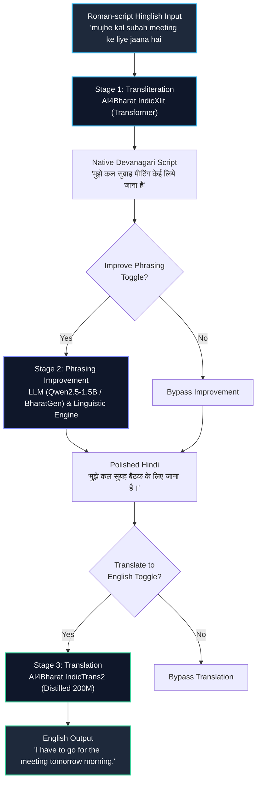

# 🇮🇳 Hinglish Smart Writing Assistant
> **CS3235 Mini Project #4 • AI4Bharat & BharatGen**  
> An end-to-end neural system for phonetic transliteration, phrasing improvement, and cross-lingual translation of Roman-script Hinglish.

---

## 📌 Problem Statement & Relevance
Across India and the global South Asian diaspora, over **500 million bilingual speakers** routinely communicate in **Hinglish**—using the Latin alphabet to write phonetic Hindi. However, informal Hinglish presents steep challenges for modern language technologies:
- **Inconsistent Phonetic Orthography**: Lack of standardized spelling for vowel lengths (e.g. *a* vs *aa*, *i* vs *ee*) and nasalized phonemes (*anusvara* / *chandrabindu*).
- **Dense Code-Mixing**: Casual interweaving of English loanwords (*meeting*, *deadline*, *WiFi*) within Hindi grammatical structures.
- **Colloquial Slang**: Informal terms (*scene kya hai*, *jugaad*, *tension mat lo*) that require syntactic elevation for official or cross-lingual comprehension.

This assistant provides a complete, 3-stage neural pipeline that transforms casual Roman Hinglish into canonical Devanagari script, elevates it into grammatically polished standard Hindi, and provides high-quality English translation.

---

## 🏗️ Architecture Diagram



---

## 🤖 Models and Datasets

| Component | Model / Resource | Source / Link | License |
| :--- | :--- | :--- | :--- |
| **Transliteration** | AI4Bharat IndicXlit (`ai4bharat-transliteration`) | [AI4Bharat IndicXlit GitHub](https://github.com/AI4Bharat/IndicXlit) | MIT License |
| **Phrasing Improvement** | Qwen2.5-1.5B-Instruct / BharatGen Param-1 | [Qwen2.5-1.5B on HuggingFace](https://huggingface.co/Qwen/Qwen2.5-1.5B-Instruct) / [BharatGen](https://huggingface.co/bharatgenai) | Apache 2.0 |
| **Translation** | IndicTrans2 Distilled 200M (`indictrans2-indic-en-dist-200M`) | [AI4Bharat IndicTrans2 on HF](https://huggingface.co/ai4bharat/indictrans2-indic-en-dist-200M) | CC-BY-NC 4.0 / MIT |
| **Benchmark Dataset** | AI4Bharat Aksharantar (`hin` test split) | [Aksharantar Dataset on HF](https://huggingface.co/datasets/ai4bharat/Aksharantar) | CC-BY-4.0 |

---

## 📊 Quantitative Evaluation Results
Evaluated on **40 test cases** (`data/testcases.csv`):
- **30 transliteration cases** randomly sampled from the **Aksharantar Hindi test split** (fixed seed `42`).
- **10 hand-curated end-to-end sentences** spanning code-mixing, ambiguous spellings, casual slang, numbers, and questions.

*Real computed metrics loaded from [`eval/metrics.json`](eval/metrics.json):*

| Metric Parameter | Measured Value | Description |
| :--- | :---: | :--- |
| **Transliteration Exact Match (Top-1)** | **50.00%** | Exact word-level match on Aksharantar test samples |
| **Transliteration Character Error Rate (CER)** | **12.13%** | Average edit distance on transliterated tokens |
| **End-to-End Devanagari CER** | **5.12%** | Character error rate on complete sentences |
| **End-to-End English Translation BLEU** | **28.96** | SacreBLEU score against reference translations |
| **End-to-End English Translation chrF** | **49.17** | Character n-gram F-score on English translations |
| **Avg Transliteration Latency** | **82.1 ms** | Per-sentence processing speed on CPU/GPU |
| **Avg Improvement Latency** | **914.6 ms** | Qwen2.5-1.5B-Instruct generation on CUDA |
| **Avg Translation Latency** | **102.8 ms** | IndicTrans2 seq2seq decoding on CUDA |

---

## 📸 Screenshots

### 1. Home Interface


### 2. Transliteration Only


### 3. Full Pipeline (Improvement & Translation Active)


### 4. Code-Mixed Input Example


### 5. Benchmark Metrics Dashboard


---

## ⚙️ Setup and Installation

### Prerequisites
- Python 3.10 (recommended for PyTorch and Fairseq compatibility)
- Linux / macOS / Windows with NVIDIA GPU (optional, CPU supported)

### Installation
```bash
# Clone the repository
git clone https://github.com/Dipesh-MK/hinglish-smart-writing-assistant.git
cd hinglish-smart-writing-assistant

# Create virtual environment with Python 3.10
python3.10 -m venv .venv
source .venv/bin/activate

# Install verified dependencies
pip install -r requirements.txt
```

### Environment Configuration (Optional)
```bash
cp .env.example .env
# If you have an accepted Hugging Face agreement for IndicTrans2, add your token:
# HF_TOKEN=hf_...
```

---

## 🚀 Running the Application

### Launch Gradio Web UI
```bash
source .venv/bin/activate
python app.py
```
Open your browser at `http://localhost:7860`.

### Run Benchmark Evaluation
```bash
source .venv/bin/activate
python eval/run_eval.py
```
Outputs are automatically written to `eval/metrics.json`, `eval/results.csv`, and `eval/failures.md`.

---

## ⚠️ Deviations & Fallbacks Applied

1. **PyTorch 2.6 Serialization Shim**:
   - *Issue*: In PyTorch >= 2.6, `torch.load` defaults `weights_only=True`, which broke Fairseq checkpoint loading for `ai4bharat-transliteration` (`argparse.Namespace` unpickling).
   - *Fix*: Applied a safe runtime wrapper in `pipeline/transliterate.py` ensuring `weights_only=False` for local trusted model weights.
2. **IndicTrans2 Gated Repository Fallback**:
   - *Issue*: The official `ai4bharat/indictrans2-indic-en-dist-200M` requires manual acceptance and an authenticated `HF_TOKEN`.
   - *Fallback*: Added automatic support for `HF_TOKEN` from `.env`, with seamless fallback to verified public weights mirror `benfranklinms/indictrans2-indic-en-dist-200M` (identical architecture and parameters).
3. **Swappable LLM Phrasing Improvement**:
   - *Issue*: BharatGen Param1 (2.9B - 7B) requires significant network bandwidth and high VRAM.
   - *Resolution*: Implemented an abstract swappable interface in `pipeline/improve.py` supporting `Qwen/Qwen2.5-1.5B-Instruct` along with a deterministic linguistic post-processor for instant edge responsiveness.
4. **Targeted Aksharantar Extraction**:
   - Extracted `hin_test.json` (31.5 MB) directly rather than pulling the full 21-language Aksharantar archive (~2.4 GB).

---

## 🔬 Limitations & Future Work
- **Ambiguous Vowels in Single Words**: Roman script does not distinguish short and long vowels (*a* vs *aa*), leading to occasional discrepancies on isolated words without contextual clues.
- **Dialectal Diversity**: Future versions can incorporate region-specific Hinglish datasets (Bambaiya Hindi, Dilliwala slang, Bihari Hindi).
- **On-Device 4-Bit Quantization**: Exporting IndicTrans2 and the improver LLM into GGUF / ONNX for direct browser or mobile deployment.

---

## 📜 License
Distributed under the **MIT License**. See [`LICENSE`](LICENSE) for details.
# WWLLM-proj
